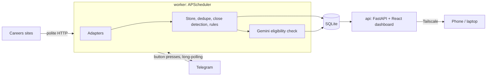

# Job Scraper

[](https://github.com/atxlya/job-scraper/actions/workflows/ci.yml)
[](LICENSE)


A self-hosted tracker for **tech internships**.
- **Reads** the official careers sites of **106 companies**, from big tech and quant firms to banks, Indian startups and government research labs, and stores every job it finds.
- **Alerts** you on Telegram the moment a new tech internship appears, with a check of whether a student in India is eligible.
- **Dashboard** for browsing, tagging and tracking your applications, reachable from your phone over Tailscale.

It runs 24/7 on a Raspberry Pi 5 with Docker Compose. [docs/DESIGN.md](docs/DESIGN.md) is the full design.

## Features

**Scraping**
- **Platform adapters:** Workday, Eightfold, Oracle HCM, Lever, Greenhouse, SuccessFactors, RSS, government notice pages and more, plus company-specific adapters for sites with their own job API.
- **Schedule:** a quick check every 30 minutes, a full sweep every night (which also detects closed jobs), and a daily re-check of the jobs you're tracking. All three can be changed from the dashboard.
- **Polite by design:** robots.txt is checked before every request, each host is rate-limited, and there's an honest User-Agent. It never gets around bot protection.
- **Accuracy checks:** each run compares its count with the total the site reports. A job is closed only when its page says "not found", or after it's missing from two complete sweeps.

**Classification**
- **Rules first:** keyword rules decide what is an internship and what is tech.
- **Gemini (free tier, paced) second:** it splits each posting into sections and quotes any line that could rule out a student in India. A quote that isn't really in the posting is thrown away.

**Telegram**
- **New-job alerts:** one alert per new tech internship, edited in place once the eligibility check finishes.
- **Tag buttons:** ❤️ Like · ✅ Applied · 🗑 Dismiss buttons on each alert.
- **Closed jobs:** "🔒 Closed" when a job you liked or applied to is taken down.
- **Health warnings:** a message when a scraper keeps failing or its job count suddenly drops.

**Dashboard** (React, light and dark, phone and laptop)
- **Finding jobs:** filters (company, country, eligibility, posted date, tag) and full-text search.
- **Triage:** keyboard shortcuts on a laptop and swipes on a phone, with Undo.
- **Applications:** stages after Applied (OA → Interview → Offer / Rejected), a timeline, and a "Your applications" page.
- **Sources:** a health page for every source, with 14-night charts, and the scraping schedule, which you can edit.
- **More:** CSV export of any filtered list, and you can add it to your phone's home screen.
- **Login:** single-user password login (argon2).

## Companies (106)

<details>
<summary><b>Big tech</b> (16)</summary>

Google · Microsoft · Amazon · Apple · IBM · Oracle · SAP · Salesforce · Adobe · Atlassian · Cisco · Dell Technologies · HP Inc · HPE · VMware (Broadcom) · Samsung R&D Institute India
</details>

<details>
<summary><b>Chips and hardware</b> (8)</summary>

NVIDIA · Intel · AMD · Qualcomm · Micron · Analog Devices · Honeywell · Philips
</details>

<details>
<summary><b>Software, cloud and developer tools</b> (13)</summary>

Databricks · MongoDB · Datadog · Elastic · GitLab · Okta · Twilio · Figma · Dropbox · Zoom · Autodesk · Rubrik · BrowserStack
</details>

<details>
<summary><b>Global consumer internet and fintech</b> (9)</summary>

Stripe · Coinbase · Robinhood · Airbnb · Pinterest · Reddit · Instacart · Lyft · Discord
</details>

<details>
<summary><b>Quant and trading</b> (13)</summary>

Jane Street · Hudson River Trading · Jump Trading · IMC Trading · DRW · Tower Research Capital · Graviton Research Capital · Squarepoint Capital · Qube Research & Technologies · WorldQuant · Virtu Financial · Akuna Capital · Five Rings
</details>

<details>
<summary><b>Banks and financial services</b> (17)</summary>

JPMorgan Chase · Morgan Stanley · Citi · Barclays · Deutsche Bank · HSBC · Wells Fargo · Capital One · American Express · Visa · Mastercard · PayPal · State Street · Northern Trust · Nasdaq · LSEG · S&P Global
</details>

<details>
<summary><b>IT services and consulting</b> (12)</summary>

Accenture · Capgemini · Cognizant · HCLTech · Wipro · Tech Mahindra · LTIMindtree · Tata Elxsi · Deloitte India · EY · KPMG India · PwC
</details>

<details>
<summary><b>Indian startups and internet</b> (14)</summary>

Razorpay · PhonePe · Paytm · CRED · Groww · Zerodha · Meesho · Myntra · Swiggy · ShareChat · InMobi · Zoho · Jio Platforms · Reliance
</details>

<details>
<summary><b>Government and research (India)</b> (4)</summary>

ISRO · DRDO · BARC · CDAC
</details>

[docs/companies.md](docs/companies.md) has the details of each source. It also lists the companies that **can't** be supported (bot protection, robots.txt, or no public listing) and why. [docs/candidate-companies.md](docs/candidate-companies.md) lists companies that were checked and could be added next.

**Adding a company:**
- **No code needed** if it uses Workday, Eightfold, Oracle HCM, Lever or Greenhouse. Paste its careers URL into the dashboard's **Add company** form; it's saved only if a test fetch returns real jobs.
- **Or edit [config/sources.yaml](config/sources.yaml)** directly.

## How it works



Three containers share one SQLite database (WAL mode):
- **`worker`** scrapes, classifies and sends alerts.
- **`api`** serves the dashboard.
- **`backup`** takes a nightly snapshot.

A fourth, `migrate`, prepares the database at start-up and then exits.

## Quick start (Mac or Linux)

You need [uv](https://docs.astral.sh/uv/) and Node 22.

```bash
git clone https://github.com/atxlya/job-scraper.git
cd job-scraper
uv sync
cd web && npm install && cd ..
cp .env.example .env                       # fill in the keys you have (see below)
uv run python -m app.cli set-password      # paste the line it prints into .env
uv run alembic upgrade head
```

Run one scrape, then open the dashboard at <http://localhost:8000>:

```bash
uv run python -m app.cli run-once --mode incremental
cd web && npm run build && cd ..
uv run uvicorn app.api.main:create_app --factory --port 8000
```

Start the scheduler in another terminal. It handles scrapes, alerts and the Telegram buttons:

```bash
uv run python -m app.worker.scheduler
```

## Run it on a Raspberry Pi

```bash
git clone https://github.com/atxlya/job-scraper.git
cd job-scraper
cp .env.example .env    # or copy your .env from the Mac
docker compose up -d --build
docker compose logs -f worker
```

The images build for arm64 and amd64. Install Docker and Tailscale on the Pi first; [docs/RUNBOOK.md](docs/RUNBOOK.md) has every step, plus backups, restoring and troubleshooting.

## Configuration

Everything goes in `.env`; see [.env.example](.env.example).

| Variable | Needed? | What it does |
|---|---|---|
| `TELEGRAM_BOT_TOKEN`, `TELEGRAM_CHAT_ID` | Optional | Alerts and tag buttons. Without them, jobs are stored and alerts wait until they're set |
| `GEMINI_API_KEY` | Optional | Eligibility checks (free tier). Without it, jobs are still stored and alerted |
| `DASHBOARD_PASSWORD_HASH` | For the dashboard | Made with `python -m app.cli set-password`; the dashboard stays locked until it's set |
| `DASHBOARD_URL` | Optional | Adds a "Dashboard" link to alerts, for example `http://my-pi:8000` |
| `GEMINI_RPM`, `GEMINI_DAILY_CAP` | Optional | Gemini pacing (defaults: 5 per minute, 250 a day) |
| `HTTP_MIN_INTERVAL_S` | Optional | Seconds between requests to one host (default 2.5) |
| `BACKUP_PUSH_TARGET` | Optional | Where the weekly backup copy is sent over SSH |

## Development

```bash
uv run pytest                          # backend tests
uv run ruff check app tests migrations scripts
cd web && npm run check                # dashboard: type-check and tests
uv run python -m app.cli live-check    # every source against the live sites
```

- **Adapter tests** use recorded real responses in [tests/fixtures/](tests/fixtures/), made with `scripts/record_fixture.py`, not invented sample jobs.
- **CI** runs the backend and dashboard tests on every push.
- **Dashboard work:** run `npm run dev` in `web/` next to the API for hot reload.

```
app/
  adapters/    one module per careers platform, or per company with its own site
  pipeline/    storing, dedupe, change and close detection, keyword rules
  llm/         Gemini provider, pacing, analysis queue
  notify/      Telegram alerts, buttons, closed-job and health messages
  worker/      scheduler, runner, Telegram long-polling
  api/         FastAPI routes, login, CSV export
  core/        settings, models, registry, tags and stages
config/        sources.yaml (company registry), keywords.yaml (classification rules)
migrations/    Alembic
web/           React + Vite + TypeScript + Tailwind dashboard
scripts/       backups, fixture recording, icon generation
docs/          design, runbook, company coverage, build history
```

## Documentation

| | |
|---|---|
| [DESIGN.md](docs/DESIGN.md) | Scope, data model, scraping rules, alerts, dashboard |
| [RUNBOOK.md](docs/RUNBOOK.md) | Setting up the bot and keys, running on the Pi, backups and restoring |
| [companies.md](docs/companies.md) | How each careers site is read, and which companies can't be |
| [candidate-companies.md](docs/candidate-companies.md) | Companies checked for adding next |
| [history/](docs/history/) | Build notes for each step: what changed, what was checked, and what wasn't |

## Scope and responsible use

- **Personal tool:** single user, meant to be reached only over a private network (Tailscale), never the open internet.
- **Public pages only:** it reads public job listings, checks robots.txt before every request, rate-limits each host, and stops at bot protection rather than getting around it.
- **Out of scope:** applying automatically, logging in to company sites, and ranking jobs against a resume.
- **Secrets:** API keys and the password hash live only in `.env`, which is git-ignored.

## License

[MIT](LICENSE)
